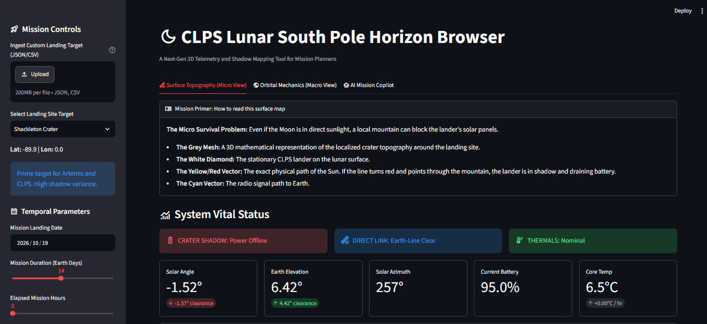
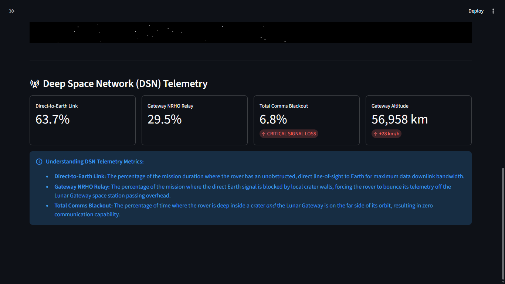
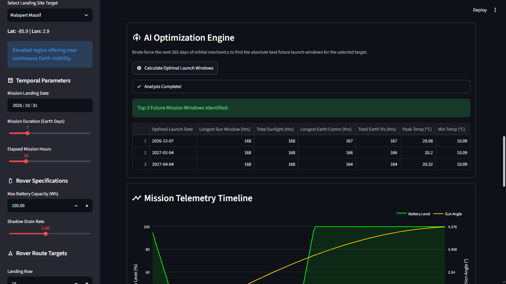
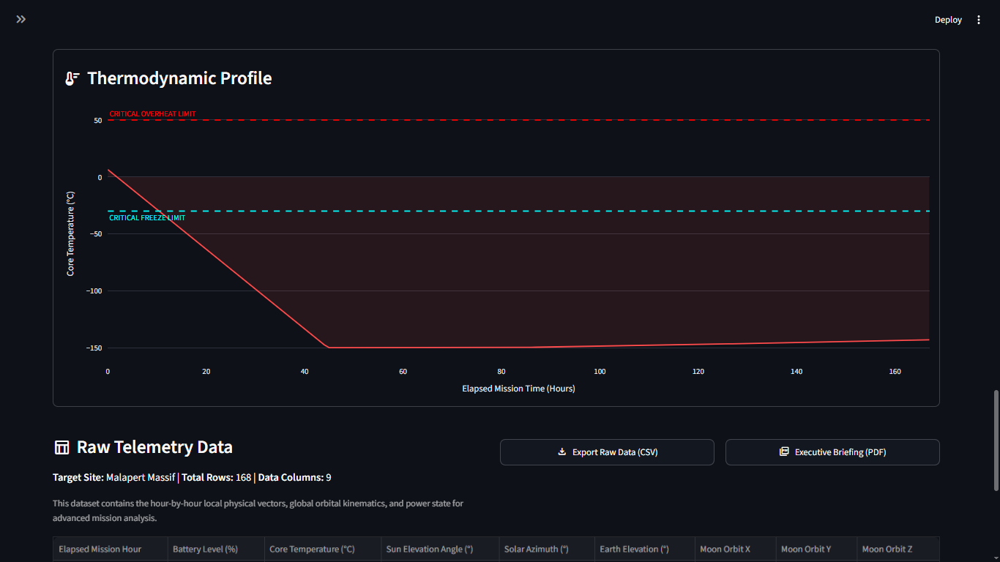
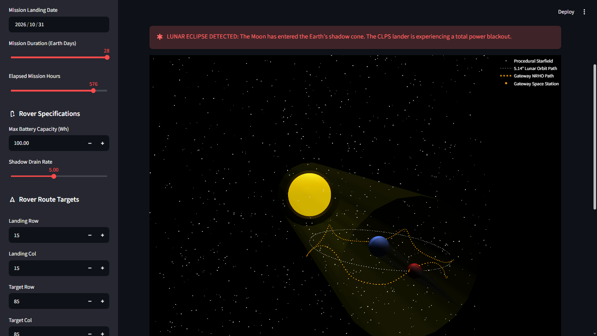
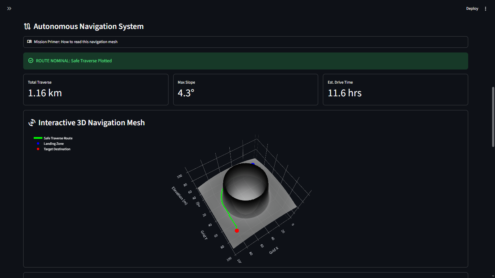
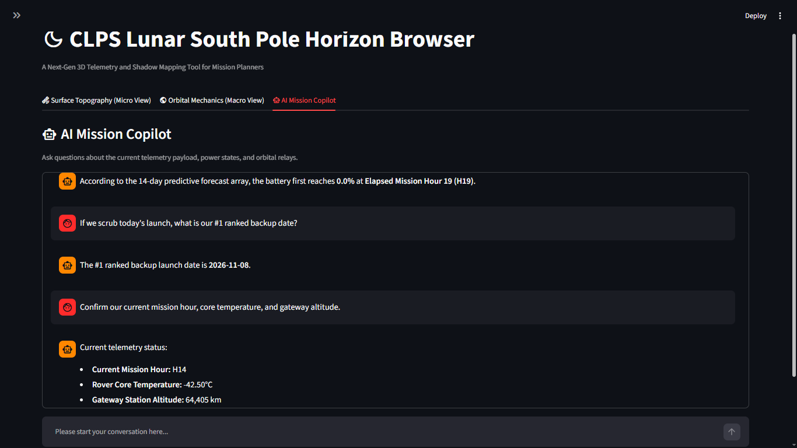
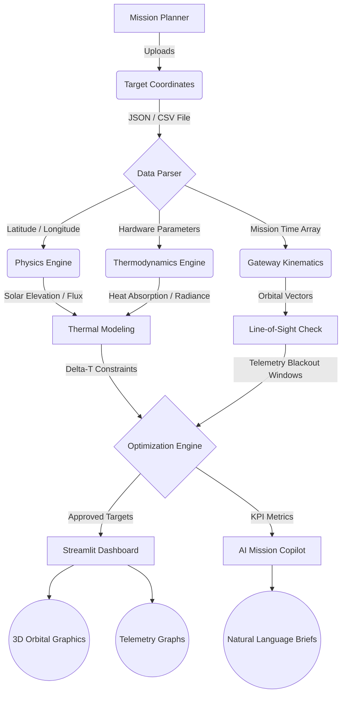
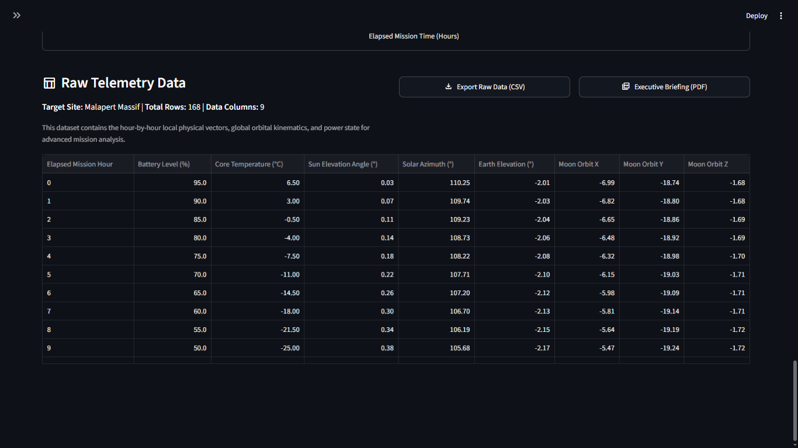

# 🌕 Lunar Mission Operations & Thermal Analysis Engine

> **Status:** Active Development  
> **Target Audience:** NASA Mission Planners, Flight Dynamics Engineers, and Non-Technical Stakeholders.
> **User Guide:** [Click here to read the step-by-step UI manual](guide.md)

## Deployment and Live Demo

**Live Application Link:** [Click here to Launch the Applicarion](https://clps-lunar-south-pole-horizon-browser-azz8mvfmt6j4x9cvgetuko.streamlit.app/)

This application is deployed live on **Streamlit Community Cloud**.

> ⚠️ **Live Demo Notice:** To optimize cloud resources, this Streamlit application pauses after periods of inactivity. Please allow roughly 15 seconds for the engine to cold-boot upon your first visit.



## 📖 1. Project Overview: Software Explained Simply

Planning a lunar mission requires balancing extreme constraints: communication blackouts, lethal thermal shifts, and precise landing windows. Currently, NASA mission planners are forced to rely on highly complex, heavily fragmented software suites. These legacy tools require steep learning curves and significant processing time, which drastically slows down mission-critical planning.

We built this engine to solve that exact problem.

This software is a **standalone, high-fidelity lunar simulation and coordinate analysis engine** designed for ultimate simplicity, accuracy, and speed. Instead of navigating convoluted systems, planners can feed this software thousands of coordinates (like our 5,000-site LRO stress test). The engine instantaneously simulates the lunar environment at those specific coordinates, testing them against brutal conditions to find the absolute safest and most efficient locations for rovers, landers, or habitats.

By streamlining these workflows, we empower NASA engineers, flight dynamicists, and non-technical stakeholders to make better, faster, and more accurate landing decisions. Whether you are a manager reviewing site viability or a NASA engineer verifying thermal tolerances, this tool translates complex orbital mechanics into actionable mission intelligence.

---

## 🧠 2. The Philosophy: Why Custom Physics over NASA APIs?

A common question is: _Why build a custom physics and math engine from scratch instead of just plugging into existing NASA or JPL APIs?_

We deliberately chose **First-Principles Mathematics** over external APIs for three critical reasons:

1. **Zero Latency & Massive Scale:** When running stress tests on 5,000+ coordinates simultaneously, making 5,000 individual network requests to an external API introduces massive bottlenecks, rate limits, and potential failure points. Processing math locally allows for instantaneous, offline calculation.
2. **Deterministic Autonomy:** Mission-critical software should not break if an external API goes down, changes its endpoint, or deprecates a dataset. By hardcoding the foundational physics (Keplerian orbits, Stefan-Boltzmann thermal radiation), our software is fully self-contained and mathematically deterministic.
3. **Edge-Case Precision:** Standard APIs often provide generalized data. We needed to push the limits—testing permanent communication blackouts on the Far Side (0.0°N, 180.0°E) and extreme solar flux variations at the Equator. Custom formulas allow us to tweak variables (like albedo and surface emissivity) with absolute control.

---

## 🎯 3. Mission KPIs & Launch Windows

To evaluate the success and safety of a landing site, the software tracks several **Key Performance Indicators (KPIs)**:

- **Maximum Continuous Solar Exposure (Days):** How long a site remains in sunlight (vital for solar-powered rovers).
- **Thermal Delta (ΔT):** The speed and severity of temperature drops during the lunar night.
- **Earth Line-of-Sight (LoS) Uptime:** Percentage of time direct communication with Earth is possible.
- **Terrain Hazard Index:** A composite score of slope, crater density, and landing safety.



### 🚀 Launch Window Calculation

The software doesn't just look at _where_ to land, but _when_. Launch windows are calculated based on:



1. **Earth-Moon Phasing:** Ensuring the spacecraft intercepts the Moon when the target site is entering its local morning (providing roughly 14 Earth days of sunlight for immediate operations).
2. **Illumination Angles:** Avoiding landing during high noon (where lack of shadows makes hazard detection difficult) or deep night (where thermal death occurs).

---

## ⚙️ 4. The Physics & Mathematics Engine

To guarantee total autonomy, speed, and precision, this software bypasses external NASA APIs to calculate orbital mechanics and thermodynamics locally. By executing the math directly in Python, the software can process thousands of coordinates (like our 5,000-site LRO dataset) in milliseconds without network latency, API rate limits, or dataset deprecation risks.

Below are the core mathematical frameworks powering the engine.

### 🔥 4.1. Thermodynamics Engine (Rover Survival)

- **Purpose:** To simulate the core temperature of a rover over time, ensuring it stays within critical operational limits (between -30°C and 50°C).
- **Rationale:** Instead of querying an API for historical surface temperatures, we modeled heat transfer in a vacuum. Why? Because a rover's temperature depends on its own design (materials, radiator size). By using first-principles physics, mission planners can tweak the variables (like heat absorption rates) to simulate _any_ custom rover or habitat, rather than just getting generic surface data.
- **The Mathematics:**
  We calculate the dynamic thermal equilibrium using the **Stefan-Boltzmann Law**, balancing the absorbed solar radiation against the heat radiated away into the vacuum of space.

  $$P_{net} = \alpha A_{sun} I_{solar} \cos(\theta) - \epsilon \sigma A_{surface} (T^4 - T_{space}^4)$$

  **Variables:**
  - $P_{net}$: Net heat transfer rate (determines how fast the rover heats or cools).
  - $\alpha$: Solar absorptivity of the rover's materials.
  - $I_{solar}$: Solar irradiance hitting the lunar surface.
  - $\theta$: Solar incidence angle.
  - $\epsilon$: Emissivity of the rover's radiators.
  - $\sigma$: Stefan-Boltzmann constant.
  - $T$: Current core temperature of the hardware (in Kelvin).
  - $T_{space}$: The deep space background temperature (approx. 3K).

- **Expected Output:** A dynamic, hour-by-hour time-series graph tracking the rover's exact temperature (°C). The engine automatically throws a `CRITICAL_FREEZE` or `CRITICAL_OVERHEAT` flag if the hardware is projected to fail.



### 🛰️ 4.2. Orbital Kinematics (Lunar Gateway NRHO Relay)

- **Purpose:** To validate three-body communication Line of Sight (LoS) clearance. We need to know exactly when the rover can talk to the Lunar Gateway, and when the Gateway can relay that signal back to Earth.
- **Rationale:** Orbital APIs can introduce severe bottlenecks during large-scale stress testing. By hardcoding Keplerian elements, we generate a highly elliptical, deterministic 3D orbit (eccentricity = 0.6, period = 156.0 hours) for the Lunar Gateway. This calculates exact signal blackout windows instantly.
- **The Mathematics:**
  First, the Gateway's orbital radius $r$ at any point in time (true anomaly $\nu$) is mapped using the classic orbital eccentricity equation:

  $$r = \frac{a(1 - e^2)}{1 + e \cos(\nu)}$$

  Next, we verify signal clearance using 3D vector projection. We calculate the minimum distance $d_{min}$ between the communication signal vector and the center of the Moon to ensure the Moon isn't physically blocking the signal:

$$
d_{min} = \frac{|\vec{p}_{rover} \times \vec{p}_{gateway}|}{|\vec{p}_{gateway} - \vec{p}_{rover}|} > R_{moon}
$$

**Variables:**

- $a$: Semi-major axis of the orbit.
- $e$: Orbital eccentricity (0.6 for our Near-Rectilinear Halo Orbit).
- $\nu$: True anomaly (angular position along the orbit).
- $\vec{p}$: 3D Cartesian vectors representing the position of the rover and Gateway.
- $R_{moon}$: The macro-radius of the Moon (acting as the physical signal blocker).

- **Expected Output:** Boolean data arrays (`True`/`False`) for `rover_to_gateway_vis` and `gateway_to_earth_vis`. If both are `True`, mission control has a confirmed telemetry link.



### ☀️ 4.3. Solar Elevation & Terrain Illumination

- **Purpose:** To determine the precise moments of sunrise and sunset at a given lunar coordinate, dictating maximum solar power generation.
- **Rationale:** At extreme target sites like the lunar South Pole (e.g., Amundsen Rim Alpha), the sun hovers just above the horizon, casting massive shadows. We calculate the exact solar elevation angle geometrically to predict the exact moment a site is plunged into the 14-day lunar night, defining the strict cutoff for our mission timeline.
- **The Mathematics:**
  The solar elevation angle $h$ is derived from spherical trigonometry, mapping the coordinate against the Moon's rotation and axial tilt:

  $$\sin(h) = \sin(\phi)\sin(\delta) + \cos(\phi)\cos(\delta)\cos(H)$$

  **Variables:**
  - $h$: Solar elevation angle. (If $h > 0$, the rover is in direct sunlight; if $h \le 0$, the rover is in darkness).
  - $\phi$: Target latitude (e.g., -84.5°).
  - $\delta$: Solar declination angle (seasonal tilt).
  - $H$: Local hour angle (calculated from the site's longitude and elapsed mission time).

- **Expected Output:** An hour-by-hour array of solar flux percentages. This directly feeds into the Thermodynamics Engine to simulate when the solar panels stop receiving light and battery drain begins.



## 🏗️ 5. System Architecture & Tech Stack

The architecture is designed to be highly modular, allowing independent engines to process heavy calculations simultaneously before piping the results into a unified, responsive dashboard.

- **Frontend (User Interface):** Built with **Streamlit** and customized with CSS, delivering a highly responsive, interactive web application. It renders 3D orbital visualizations (`orbital_graphics.py`) and dynamic time-series charts (`telemetry_graphs.py`) directly in the browser without requiring local software installation.
- **Backend & Data Processing:** Powered by **Python**, heavily utilizing **Pandas** and **NumPy** for rapid vector and matrix computations. This allows the system to chew through massive datasets (like a 5,000-target stress test) locally and efficiently.
- **The Core Engines:**
  - `physics_engine.py`: Handles geometric mapping and solar elevation tracking.
  - `thermodynamics_engine.py`: Calculates vacuum heat transfer and baseline hardware limits.
  - `gateway_kinematics.py`: Processes 3D orbital vectors for the Gateway space station.
  - `spatial_pathfinder.py` & `terrain_analyzer.py`: Assesses surface hazards and site viability.
- **Automated Reporting:** `report_generator.py` compiles the processed data into actionable, downloadable summaries for mission control.

---

## 🤖 6. AI Integration: The Mission Copilot

A massive dataset of 5,000 lunar coordinates generates an overwhelming amount of telemetry. To bridge the gap between complex flight dynamics and non-technical stakeholders, we integrated an AI layer (`mission_copilot.py`).



**How the AI Accelerates Mission Planning:**
Instead of manually hunting for the best site, a NASA planner can interact with the Mission Copilot in natural language.

- **Intelligent Filtering:** Ask the Copilot, _"Which of the Far Side targets survive the thermal limits for more than 10 days?"_ The AI instantly cross-references the thermodynamic outputs and returns the top candidates.
- **KPI Interpretation:** The AI contextualizes the Key Performance Indicators. If a target site triggers a `CRITICAL_FREEZE` warning, the Copilot explains _why_ based on the exact solar elevation drop-off and suggests alternative launch windows.
- **Executive Summaries:** The Copilot automatically drafts mission viability briefs for management, summarizing the highest-ranking sites identified by the `optimization_engine.py`.

---

## 🔄 7. Operational Flowchart & Data Lifecycle

Below is the logical flow of how a raw coordinate is transformed into a validated mission target.



## 📂 8. Project Directory Structure

The repository is modularly organized to separate frontend rendering, backend physics calculations, and data ingestion.

```text
📦 lunar-mission-engine
 ┣ 📜 app.py                        # Main Streamlit frontend application
 ┣ 📜 requirements.txt              # Python dependencies (pandas, numpy, streamlit, etc.)
 ┣ 📜 Testing.py                    # Unit tests and system validation scripts
 ┣ 📂 core_engines/                 # Backend Mathematics & Physics Modules
 ┃ ┣ 📜 physics_engine.py           # Solar elevation and geometric mapping
 ┃ ┣ 📜 thermodynamics_engine.py    # Stefan-Boltzmann vacuum heat transfer
 ┃ ┣ 📜 gateway_kinematics.py       # 3D orbital mechanics and line-of-sight
 ┃ ┣ 📜 optimization_engine.py      # Target ranking and KPI filtering
 ┃ ┣ 📜 terrain_analyzer.py         # Surface hazard assessment
 ┃ ┗ 📜 spatial_pathfinder.py       # Landing trajectory mapping
 ┣ 📂 ui_components/                # Dashboard Visualizations
 ┃ ┣ 📜 orbital_graphics.py         # 3D interactive orbit plotting
 ┃ ┣ 📜 telemetry_graphs.py         # Time-series thermal/solar charting
 ┃ ┗ 📜 report_generator.py         # Automated executive summary exports
 ┣ 📂 ai_layer/
 ┃ ┗ 📜 mission_copilot.py          # Natural language AI query assistant
 ┗ 📂 data/                         # Mission Coordinate Datasets
   ┣ 📜 nasa_stress_test_5000.csv   # Massive LRO survey dataset
   ┣ 📜 my_custom_site.json         # High-altitude custom target (Amundsen Rim)
   ┣ 📜 equator_test.csv            # Max solar flux QA test
   ┣ 📜 farside.csv                 # Comm-blackout QA test
   ┗ 📜 sabotage_test.csv           # Edge-case/fault injection dataset
```

## 🗄️ 9. Data Infrastructure & Input Schema

To ensure seamless collaboration between external teams, flight dynamicists, and non-technical stakeholders, the engine accepts coordinate targets in both **CSV** and **JSON** formats.

Regardless of the file type, the data parser strictly requires four fundamental columns/keys to initiate a simulation:

| Field Name    | Data Type | Description                                                                    |
| :------------ | :-------- | :----------------------------------------------------------------------------- |
| `name`        | String    | A unique identifier for the landing site (e.g., _Amundsen Rim Alpha_).         |
| `latitude`    | Float     | The site's latitude from `-90.0` (South Pole) to `90.0` (North Pole).          |
| `longitude`   | Float     | The site's longitude from `-180.0` to `180.0`.                                 |
| `description` | String    | Contextual notes for the mission planner (e.g., _Automated survey candidate_). |



---

## 📊 10. Dataset Breakdown & The 5,000-Target Stress Test

The engine ships with several pre-configured datasets designed to validate the software against extreme lunar environments.

- **The NASA Stress Test (`nasa_stress_test_5000.csv` / `.json`):**
  This is the ultimate performance benchmark. It contains exactly 5,000 automated Lunar Reconnaissance Orbiter (LRO) survey candidates. By feeding this into the engine, we test the system's ability to simultaneously compute solar flux, thermal degradation, and orbital visibility for thousands of coordinates without crashing or lagging.
- **The Equator Baseline (`equator_test.csv`):**
  Contains a single target (`Equator Oven` at 0.0° Lat, 0.0° Lon). This isolates the thermodynamics engine, testing how the simulated hardware handles maximum direct solar irradiance without the interference of deep polar shadows.
- **The Far Side Blackout (`farside.csv`):**
  Targeting 0.0° Lat, 180.0° Lon. This validates the `gateway_kinematics.py` module by intentionally triggering a permanent Earth communication blackout, forcing the system to rely entirely on the Gateway NRHO relay for telemetry.
- **High-Altitude Focus (`my_custom_site.json`):**
  Features `Amundsen Rim Alpha` (-84.5° Lat, 85.6° Lon). A prime operational candidate testing extended solar exposure on elevated polar terrain.

**Team Name: Lunar Horizon Analytics**
**Engineered By: Irfan Khattak & Mohammad Abdullah**
