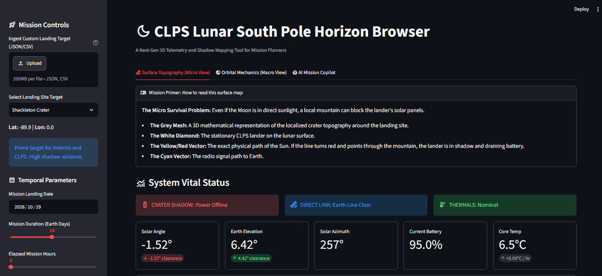
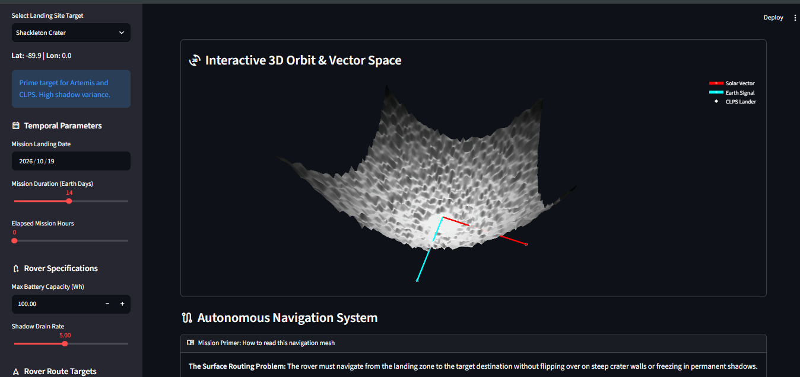
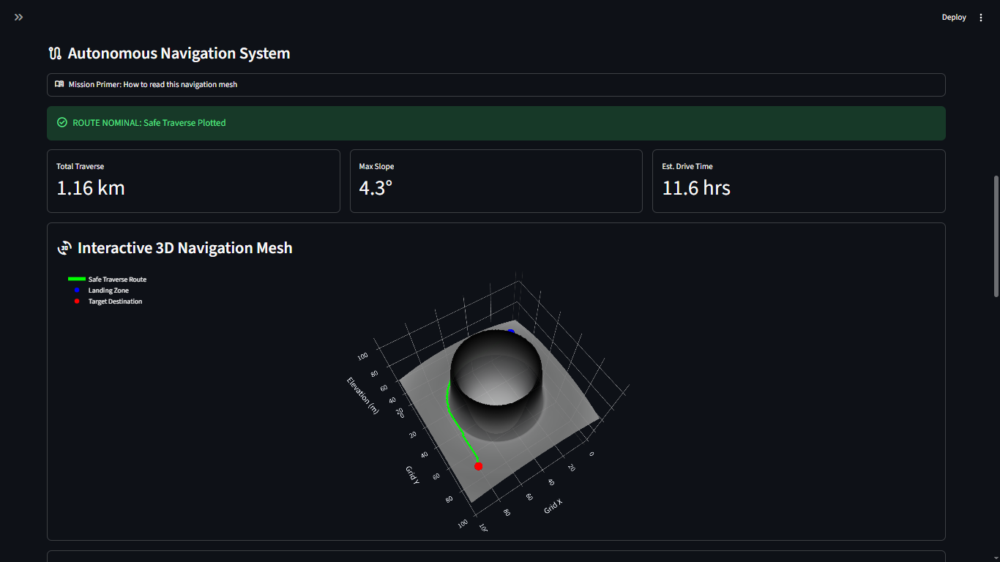
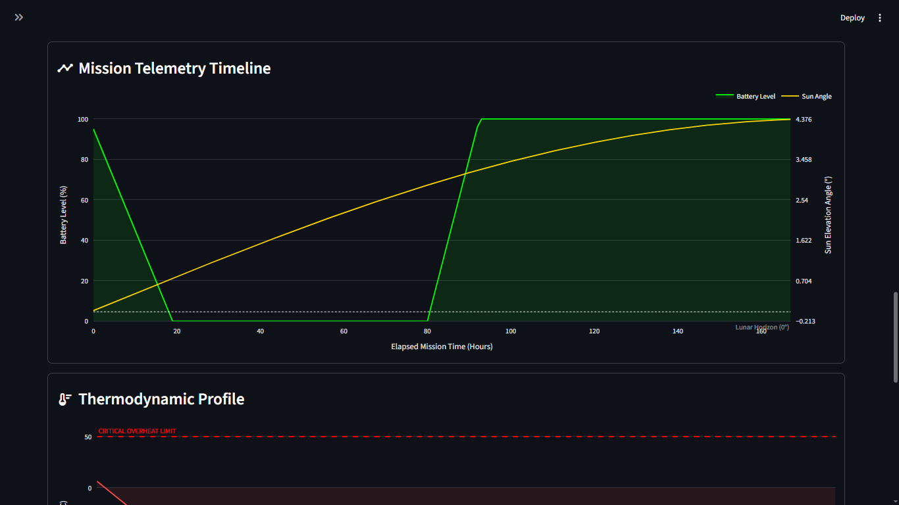
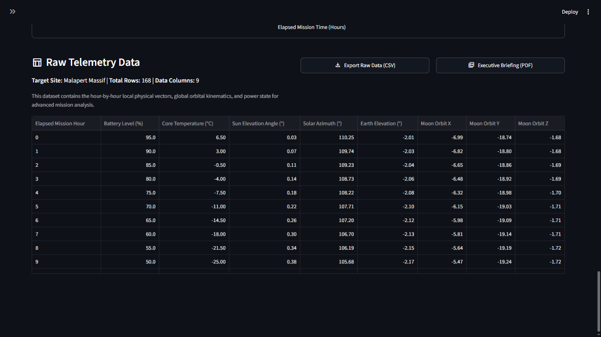
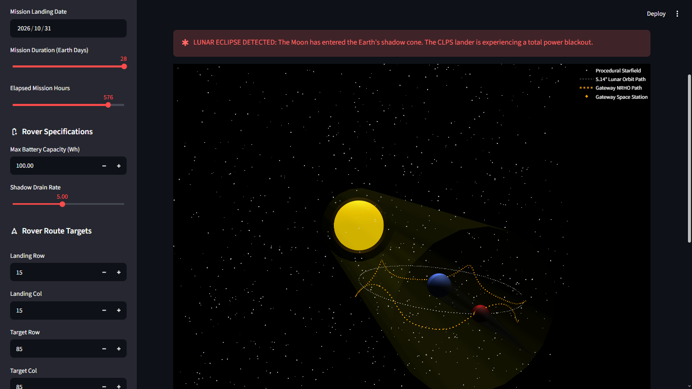
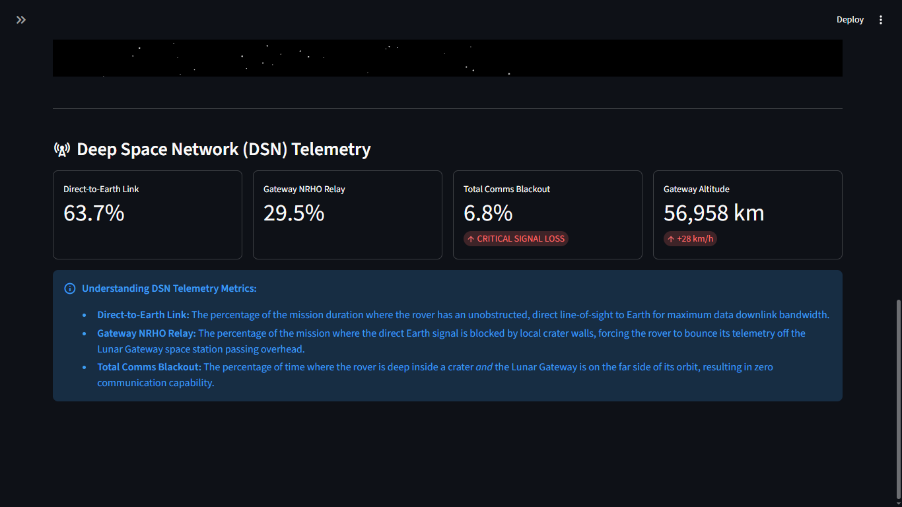
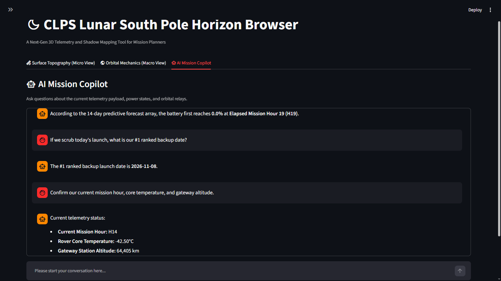

# 🌕 CLPS Lunar South Pole Horizon Browser: Official User Guide

This guide provides a complete, step-by-step walkthrough for operating the CLPS Lunar South Pole Horizon Browser. Designed for mission planners and flight dynamicists, this tool maps 3D telemetry, thermodynamics, and orbital relays to ensure surface asset survival.

---

## 🎛️ 1. Mission Controls (Configuration)

The left-hand sidebar is your primary control panel for initializing mission parameters. All changes made here immediately update the simulation across all tabs.

- **Ingest Custom Landing Target:** Upload custom JSON or CSV files containing specific lunar coordinates. The system supports files up to 200MB.
- **Select Landing Site Target:** Choose a pre-loaded site from the dropdown menu (e.g., _Malapert Massif_). The latitude, longitude, and site description will display directly below.
- **Temporal Parameters:**
  - _Mission Landing Date:_ Set the exact Earth date for touchdown.
  - _Mission Duration (Earth Days):_ Define the total length of the simulation.
  - _Elapsed Mission Hours:_ Use this slider to scrub forward and backward through the mission timeline to see dynamic changes in shadows and temperature.
- **Rover Specifications:** Adjust the physical capabilities of your hardware, including Max Battery Capacity (Wh) and Shadow Drain Rate.
- **Rover Route Targets:** Define specific start and end points for the rover on the localized grid (Landing Row/Col and Target Row/Col).

---

## 🔬 2. Surface Topography (Micro View)

The primary tab focuses on the immediate survival and navigation of the surface asset.

- **System Vital Status:** Real-time gauges at the top display critical metrics for the current hour: Solar Angle, Local Elevation, True Azimuth, Current Battery percentage, and Core Temp.
- **Interactive 3D Orbit & Vector Space:** A localized 3D visualization showing the immediate terrain topography and solar vector angles.

- **Autonomous Navigation System & 3D Mesh:** Evaluates the safest path from the landing zone to the target destination, visualizing the route on a 3D surface mesh (green for landing, red for target). It calculates total distance, max slope, and estimated drive time.

- **Mission Telemetry Timeline & Thermodynamic Profile:** Line charts that forecast battery life and core temperature over the duration of the mission. These graphs will visually warn you if the hardware crosses critical freeze/overheat thresholds.

- **Raw Telemetry Data:** A comprehensive data table at the bottom of the page logs hour-by-hour metrics. You can export this data via the "Export CSV" or "Export JSON" buttons for external analysis.

---

## 🪐 3. Orbital Mechanics (Macro View)

The second tab zooms out to show the Earth-Moon-Sun kinematics dictating the surface conditions.

- **Solar System Kinematics:** A 3D procedural starfield visualizes the macro mechanics.
  - _Black Cones (Umbra):_ Physical shadows cast by celestial bodies.
  - _Red Moon (Eclipse):_ Indicates if the Moon passes through Earth's shadow, causing a total power blackout.
  - _Gateway NRHO Relay:_ The orange dotted line tracks the Lunar Gateway space station. If the Moon blocks direct communication with Earth, the cyan beam indicates an active bounce relay through the Gateway.

- **Deep Space Network (DSN) Telemetry:** This section breaks down communication capabilities over the mission duration. It provides percentage uptimes for the Direct-to-Earth Link, Gateway NRHO Relay, and Total Comms Blackout, alongside the live Gateway Altitude.

---

## 🤖 4. AI Mission Copilot

The final tab is your deterministic flight controller interface.

- **Querying the AI:** Instead of manually scrubbing data arrays, you can ask the AI questions in natural language regarding live surface topography, kinematics, and telemetry forecasts.
- **Suggested Prompts:** Use commands like "Scan the 14-day array. At what exact hour does the battery reach 0.0%?" or "Confirm our current mission hour, core temperature, and gateway altitude" to quickly extract critical mission intelligence. Type your queries into the chat bar at the bottom of the screen.
